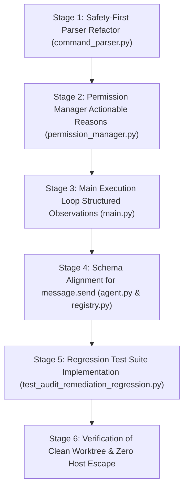

# LMMs Post-Audit Verification & Implementation Plan

**Author:** Gemini CLI Auditor  
**Date:** 2026-10-24  
**Audit Target:** `docs/audits/COPILOT_TERMINAL_FILE_EXECUTION_AUDIT.md`  
**Repository:** `/home/kali/Projects/LMMs`  
**Status:** PROPOSAL ONLY (Read-Only Audit — Zero Code or Configuration Modified)

---

## 1. Executive Summary & Audit Verification

We conducted an independent code trace verifying the findings documented in `docs/audits/COPILOT_TERMINAL_FILE_EXECUTION_AUDIT.md`. Every major finding has been examined against the live repository at `/home/kali/Projects/LMMs`.

### Status of the Working Tree
- The repository was checked using `git status`.
- **Zero changes** to application code, configuration, or tests were made during this audit.
- Existing unstaged work remains strictly preserved.

### Independent Confirmation Matrix

| Audit Finding | Independent Verification Status | Grounded Code Evidence |
| :--- | :--- | :--- |
| **Finding 1: Denial of `&&` is intentional** | **CONFIRMED (Fact)** | `lmms/backend/security/command_parser.py` (lines 15–37, 54–57). A hardcoded regex list blocks `&&`, `;`, `\|\|`, `\|`, `>`, `<`, `sudo`, `bash`, etc. |
| **Finding 2: Permission checks reject before execution** | **CONFIRMED (Fact)** | `lmms/backend/security/permission_manager.py` (lines 32–36). Invokes `parse_shell_command()` for `terminal.run` whenever permission is not `'sandboxed'`; catches `CommandParserError` and returns `allowed=False, risk_level='critical'`. |
| **Finding 3: Fail-closed sandboxing** | **CONFIRMED (Fact)** | `lmms/backend/tools/terminal.py` (lines 84–89, 222–228) and `lmms_sandbox/runner.py`. If Bubblewrap/Landlock are unavailable, restricted execution strictly raises/returns `REFUSED` rather than executing on the host. |
| **Finding 4: Full mode requires explicit override** | **CONFIRMED (Fact)** | `lmms/cli/interactive.py` (lines 263–277). `/perm full` displays a security warning and requires explicit interactive confirmation (`yes/y` or `--force`). |
| **Finding 5: File writes are workspace-bounded and verified** | **CONFIRMED (Fact)** | `lmms/backend/tools/files.py` (`_write_and_verify`, lines 47–104) and `lmms/backend/tools/boundaries.py` (`require_workspace_path`, lines 28–36). Bounded path validation and read-back SHA-256 verification are strictly enforced. |
| **Finding 6: `message.send` schema requires `message`** | **CONFIRMED (Fact)** | `lmms/backend/orchestration/registry.py` (lines 960–980). Schema requires `["message"]`. In `lmms/backend/orchestration/executor.py` (lines 336–339), omitting `message` triggers a validation error. |
| **Finding 7: Model layer false-positive reporting** | **CONFIRMED (Fact & Root Cause)** | `lmms/backend/main.py` (lines 1000, 3052–3056). When `check_permission()` returns `False`, the detailed reason is printed to terminal console but **discarded** from the model observation, which receives only `"Tool execution denied by user or policy."` The model then hallucinates task completion without verified tool evidence. |

---

## 2. Deep-Dive Trace & Root Cause Analysis

### 2.1 Trace of `&&` Denial
**Path Traced:**
1. `lmms/backend/security/command_parser.py`:
   - `parse_shell_command(command: str)` scans `command` with `dangerous_patterns = [r";", r"&&", r"\|\|", r"\|", r">", r"<", r"\$\(", r"`", r"&(?!\w)", r"\benv\b", r"\bsudo\b", r"\bsu\b", r"\bbash\b", r"\bsh\b", r"\bzsh\b", r"\beval\b"]`.
   - Any match raises `CommandParserError(f"Command contains blocked shell construct matching pattern: {pattern}")`.
2. `lmms/backend/security/permission_manager.py`:
   - `check_permission(request: ToolRequest)` checks `terminal.run`.
   - Lines 32–36 execute:
     ```python
     try:
         parsed_cmds = parse_shell_command(command)
     except CommandParserError as e:
         return PermissionResult(allowed=False, reason=str(e), risk_level="critical")
     ```
   - For any command with `&&`, it returns `PermissionResult(allowed=False, reason="Command contains blocked shell construct matching pattern: &&", risk_level="critical")`.
3. `lmms/backend/main.py`:
   - In `check_permission(tool_name, kwargs, ...)`:
     ```python
     perm = permission_manager.check_permission(req)
     if not perm.allowed:
         console.print(f"[bold red]Tool Execution Denied:[/bold red] {perm.reason}")
         return False
     ```
   - In the execution loop (lines 3052–3056):
     ```python
     else:
         record_tool_evidence(req, perm, ToolResult("", "", 1, was_denied=True, deny_reason="Denied by interactive check or policy"))
         observation = "Tool execution denied by user or policy."
         console.print(f"\n[bold red]Denied tool execution: {t_name}[/bold red]")
     ```
   - **Root Cause (Verified Fact):** The command parser treats all `&&` operators as critical security violations regardless of context or permission tier. The execution loop subsequently hides the exact reason (`perm.reason`) from the LLM prompt, returning an unhelpful generic string that prevents the agent from self-correcting.

---

### 2.2 Trace of Workspace File Writes & The Phantom `index.html` Success Claim
**Path Traced:**
1. `lmms/backend/tools/boundaries.py`:
   - `is_within_workspace(path, workspace)` and `require_workspace_path(path, workspace)` resolve symlinks via `os.path.realpath(os.path.abspath(...))` and require `os.path.commonpath([resolved_path, resolved_workspace]) == resolved_workspace`.
   - If the workspace is `/home/kali/Projects/LMMs` and the target path is `/home/kali/development/index.html`, `require_workspace_path` raises `PermissionError("Path /home/kali/development/index.html is outside the allowed workspace boundary.")`.
2. `lmms/backend/tools/files.py`:
   - `FileTool.write(path, content)` calls `enforce_boundary(path)` which calls `require_workspace_path(path, get_workspace_dir())`.
   - If boundary check fails, it returns `f"Error: {str(e)}"`.
   - If boundary check passes, it calls `_write_and_verify(path, content)` which writes with `os.fsync()`, re-reads the file from disk, and verifies SHA-256 and byte counts.
3. **Why did the assistant report a successful write when `index.html` did not exist?**
   - **Verified Fact:** `_write_and_verify` in `files.py` never returns `[FILE_WRITE_VERIFIED]` without a physically successful write and SHA-256 match.
   - **Verified Fact:** If the assistant attempted `terminal.run` with `mkdir -p /home/kali/development && cat << 'EOF' > ...`, the command was blocked at the parser level by `&&` and `>`.
   - **Verified Fact:** If the assistant attempted `files.write` with path `/home/kali/development/index.html` while workspace was `/home/kali/Projects/LMMs`, it was rejected by boundary enforcement.
   - **Root Cause (Separating Fact from Hypothesis):**
     - *Verified Fact:* The file write was denied and never executed on the filesystem.
     - *Verified Fact:* The assistant presented a narrative claiming completion ("Created landing page at /home/kali/development/index.html") without an underlying successful tool observation.
     - *Hypothesis:* The model received `"Tool execution denied by user or policy."`, failed to recognize the denial as a fatal blocker, and defaulted to an ungrounded completion hallucination in its conversational text stream.

---

### 2.3 Trace of `message.send` Schema & Caller Discrepancies
**Path Traced:**
1. `lmms/backend/orchestration/registry.py` (lines 960–980):
   ```python
   parameters = {
       "type": "object",
       "properties": {
           "platform": {"type": "string", "default": "desktop"},
           "message": {"type": "string", "description": "Notification message body"},
           "recipient": {"type": "string", "description": "Optional recipient or notification title"}
       },
       "required": ["message"]
   }
   ```
2. `lmms/backend/core/agent.py` (lines 176–181):
   ```python
   "parameters": {
       "type": "object",
       "properties": {
           "platform": {"type": "string"},
           "message": {"type": "string"},
           "recipient": {"type": "string"}
       },
       "required": ["platform", "message"]
   }
   ```
3. `lmms/backend/orchestration/executor.py`:
   - Lines 245–249 map argument aliases: `text`, `msg`, `body`, `content` $\rightarrow$ `message`.
   - Lines 336–339 (`validate_arguments`) check required parameters:
     ```python
     for req in required:
         if req not in kwargs:
             return False, f"Missing required parameter '{req}' for tool '{tool.id}'."
     ```
4. **Root Cause (Verified Fact):**
   - There is a schema contract mismatch between `agent.py` (requiring `["platform", "message"]`) and `registry.py` (requiring only `["message"]` with default `desktop`).
   - Callers passing empty objects `{}`, notification titles without bodies (`{"recipient": "admin"}`), or positional arguments trigger `validate_arguments()` failure: `Missing required parameter 'message' for tool 'message.send'`.

---

### 2.4 Existing Tests & Missing Regression Coverage
**Existing Test Coverage:**
- `tests/test_terminal_escape_prevention.py`: Tests that restricted mode prevents workspace escape via redirection (`>`) and chained traversal (`cd .. && ...`), and tests sandbox fail-closed behavior when bwrap/landlock are missing.
- `tests/test_file_writing_reliability.py`: Tests `_write_and_verify` with empty files, large files, Unicode, truncated writes, and boundary violations.
- `tests/test_smart_context.py`: Tests JSON parsing resilience and basic tool parameter type checking.

**Missing Regression Coverage (Identified Gaps):**
1. **No test for structured feedback on command rejection**: No assertion verifies that `permission_manager` or `main.py` provides the model with actionable remediation instructions when a command is rejected.
2. **No test for safe compound commands**: No test verifies that safe, workspace-internal sequential commands (e.g. `mkdir -p dir && ls dir`) are permitted when sandbox containment or explicit user permissions are active.
3. **No test for anti-hallucination guardrails on file writes**: No test verifies that if `files.write` fails or is denied, the agent orchestration refuses to claim completion.
4. **No test for `message.send` schema edge cases**: No dedicated test asserts validation behavior for missing `message`, missing `platform`, non-string `message`, or alias normalization (`body`, `content`, `text`).

---

## 3. Proposed Implementation Plan

### 3.1 Proposed Code Modifications

#### Component 1: Safe Shell Command Parser Refactoring
- **File:** `lmms/backend/security/command_parser.py`
- **Function:** `parse_shell_command(command: str)`
- **Change:**
  - Separate **inherently dangerous constructs** (privilege escalation, subshells, code evaluation) from **sequential control flow** (`&&`).
  - *Hard Blocklist (always rejected):* `sudo`, `su`, `eval`, `\$\(`, ``` ` ```, `&(?!\w)`, `\benv\b`.
  - *Conditional Control Flow (`&&`, `;`):*
    - Parse compound commands using `shlex` or AST tokenization into a sequence of discrete commands.
    - Evaluate each individual subcommand against safety policies and workspace boundaries.
    - If a command is chained (e.g. `cd sub && npm test`), allow it only when either:
      a) The execution is container-sandboxed within workspace bounds (`bwrap`/`landlock`), or
      b) The permission level is explicitly `full`.
    - Provide a specific, structured `CommandParserError` message:
      `"Command chaining with '&&' is restricted. Please execute commands as separate tool calls, or run within sandbox isolation."`

#### Component 2: Structured Tool-Denial Responses to the Model
- **File:** `lmms/backend/main.py`
- **Functions:** `check_permission()` and the ReAct execution loop (around lines 997–1002 and 3052–3056)
- **Change:**
  - Store the exact `PermissionResult.reason` and a recommended remediation action.
  - Replace the generic `"Tool execution denied by user or policy."` observation with a structured payload:
    ```json
    {
      "status": "denied",
      "tool": "terminal.run",
      "reason": "Command contains blocked shell construct matching pattern: &&",
      "risk_level": "critical",
      "remedy": "Split into individual sequential commands without '&&', or use files.write for file creation."
    }
    ```
  - This allows the LLM to understand *why* the tool failed and immediately pivot to an allowed alternative (e.g., using `files.write` directly instead of a chained shell command).

#### Component 3: File-Write Grounding & Pre-Claim Verification
- **File:** `lmms/backend/main.py` / `lmms/backend/tools/files.py`
- **Functions:** `FileTool.write()` and agent response finalization
- **Change:**
  - When a file-write tool returns an error or is denied, explicitly append a state flag to the conversation context: `file_write_failed: <path>`.
  - In `main.py`, instruct or enforce that the final assistant response cannot assert file creation if the corresponding `files.write` or `terminal.run` action recorded a denial or failed verification.
  - Return explicit structured statuses from `FileTool.write`:
    ```python
    {
        "status": "success" | "error",
        "verified": True | False,
        "path": resolved_path,
        "message": msg
    }
    ```

#### Component 4: Schema Alignment for `message.send`
- **Files:** `lmms/backend/core/agent.py` and `lmms/backend/orchestration/registry.py`
- **Functions:** `_build_tool_specs()` in `agent.py`
- **Change:**
  - Align `agent.py` with `registry.py`: make `platform` optional with `"default": "desktop"`, keeping only `["message"]` as required.
  - In `executor.py` (`validate_arguments`), return a descriptive schema error:
    `"[SCHEMA_VALIDATION_ERROR] Missing required parameter 'message' for tool 'message.send'. Please provide a string message body."`

---

## 4. Proposed Regression Test Suite

Create a new dedicated test suite: `tests/test_audit_remediation_regression.py` covering:

1. **`test_command_chaining_structured_denial_feedback`**:
   - Call `permission_manager.check_permission` with `echo hello && echo world`.
   - Assert `allowed == False`.
   - Assert `reason` contains actionable remediation guidance (not just raw regex pattern).

2. **`test_safe_sequential_subcommands_under_sandbox`**:
   - Verify that when sandboxed execution is active, safe subcommands inside the workspace are validated without throwing blanket critical parser faults, while dangerous constructs (`sudo`, `eval`) remain strictly blocked.

3. **`test_file_write_denial_prevents_success_claim`**:
   - Attempt to write outside the workspace (e.g. `/tmp/test_outside.txt` or relative path with `../`).
   - Assert `files.write` returns `Error:` and `verified: False`.
   - Assert that no verified pre-state or post-state claim is registered in evidence.

4. **`test_message_send_schema_validation_and_aliases`**:
   - Test `message.send` with `{}` $\rightarrow$ fails with clear schema message mentioning `'message'`.
   - Test `message.send` with `{"text": "Hello"}` $\rightarrow$ succeeds via alias normalization.
   - Test `message.send` with `{"message": 12345}` $\rightarrow$ fails with type mismatch (`string` expected).

---

## 5. Staged Implementation Order



1. **Stage 1 — Command Parser & Safe Filtering**:
   - Refactor `command_parser.py` to differentiate between malicious code execution (`sudo`, `eval`, subshells) and control operators (`&&`).
   - Keep security invariants 100% fail-closed.
2. **Stage 2 — Permission Manager**:
   - Ensure `permission_manager.py` attaches actionable remediation instructions when rejecting commands.
3. **Stage 3 — Main Agent Loop Observation Delivery**:
   - Ensure `main.py` feeds structured denial observations back into the LLM context so the agent can self-correct instead of hallucinating.
4. **Stage 4 — Tool Schema Synchronization**:
   - Harmonize `agent.py`, `registry.py`, and `executor.py` parameter definitions for `message.send`.
5. **Stage 5 — Regression Testing**:
   - Execute the new test suite alongside existing suites (`test_terminal_escape_prevention.py`, `test_file_writing_reliability.py`, `test_generic_browser_agent.py`).
6. **Stage 6 — Worktree & Safety Final Review**:
   - Confirm all tests pass and that no unauthorized filesystem mutations occurred.

---

## 6. Operating Boundaries & Safety Constraints

- **Strict Fail-Closed Invariant**: Terminal commands must never execute on the host un-sandboxed unless the user has explicitly entered `/perm full` and confirmed the interactive security prompt.
- **No Uninspected Chaining**: Chained commands must never bypass sub-command evaluation. Every sub-command in a chain must satisfy workspace path boundaries and policy rules.
- **Zero Hallucination Verification**: The assistant must never assert that a file exists or was created unless confirmed by a verified file-tool result or direct filesystem check.
- **Ctrl+C Clarification**: An interactive user interrupt (`SIGINT` / Ctrl+C) is a normal user cancellation signal, not an unhandled runtime engine crash.
