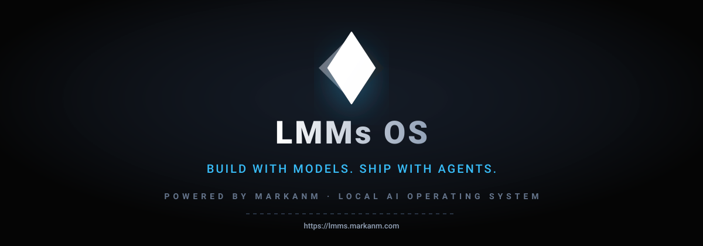
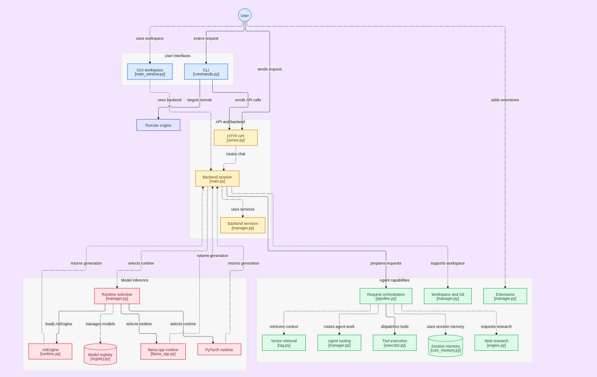

<div align="center">
  <a href="https://lmms.markanm.com">
    
  </a>
</div>

<p align="center">
  <strong>Bangun dengan model. Rilis dengan agen.</strong><br>
  <em>Sistem operasi AI lokal berbasis Python murni oleh pendiri Raj Singh (MarkanM)</em>
</p>

<p align="center">
  <a href="https://lmms.markanm.com"></a>
  <a href="https://pypi.org/project/lmms"></a>
  <a href="#license"></a>
  
  
</p>

---

### 🌐 Select Language / भाषा चुनें / Выберите язык / 选择语言

<div align="center">

[](../../README.md)
[](README_hi.md)
[](README_ru.md)
[](README_zh.md)
[](README_fr.md)
[](README_es.md)
[](README_de.md)
[](README_ja.md)
[](README_ko.md)
[](README_ar.md)
[](README_pt.md)
[](README_it.md)
[](README_tr.md)
[](README_vi.md)
[](#)
[](README_bn.md)
[](README_pa.md)
[](README_mr.md)
[](README_ur.md)
[](README_th.md)

</div>


<p align="center">
  <a href="https://lmms.markanm.com">Situs Resmi</a> ·
  <a href="#system-architecture">Arsitektur Sistem</a> ·
  <a href="#deep-technical-capabilities">Kemampuan Utama</a> ·
  <a href="#quick-start">Mulai Cepat</a> ·
  <a href="#architecture-setup-wizard-lmms-install">Panduan Instalasi</a> ·
  <a href="#enterprise-infrastructure--super-host">Perusahaan</a> ·
  <a href="#core-command-reference">Referensi Perintah</a> ·
  <a href="#cli-slash-commands">Perintah Slash</a> ·
  <a href="#license">Lisensi</a>
</p>

---

## Apa itu LMMs OS?

LMMs adalah lapisan operasi AI berbasis Python murni untuk menjalankan model secara lokal dan jarak jauh. Dibuat oleh pendiri Raj Singh (MarkanM), sistem ini memadukan studio GUI desktop nyata, CLI pengembang cerdas, dan mesin inferensi matang agar pengembang dan tim dapat menjalankan model multimodal besar tanpa telemetri dan tanpa ketergantungan cloud.

* **Inti Mesin Ganda Asli**: Inferensi kuantisasi GGUF berkecepatan tinggi via llama.cpp dan eksekusi safetensors asli PyTorch.
* **Skala Tanpa Batas dengan AirEngine**: Offloading tensor dinamis antara GPU, CPU, dan disk memungkinkan eksekusi model 70B+ di laptop standar.
* **Studio Desktop (GUI)**: Editor kode Monaco, peninjau diff visual, integrasi Git, dan manajemen alat bawaan.
* **Studio Terminal (CLI)**: Shell interaktif dengan lebih dari 30 perintah slash, pair programming, orkestrasi sub-agen, dan sandbox aman.
* **Siap untuk Skala Enterprise**: Kluster klien-server terdistribusi melalui jaringan privat LAN/VPC dengan penemuan host otomatis.

---

## Arsitektur Sistem

Diagram berikut mengilustrasikan arsitektur menyeluruh LMMs OS yang mencakup antarmuka, layanan backend, inferensi model, dan kemampuan agen:

<div align="center">
  
</div>

### Architectural Subsystems:

1. **Antarmuka Pengguna**: `GUI workspace [main_window.py]` (IDE Monaco dan review diff) dan `CLI [commands.py]` (terminal interaktif pengembang).
2. **API & Lapisan Backend**: `HTTP API [server.py]` (daemon FastAPI di port 11435), `Backend session [main.py]` (koordinator sesi), dan `Backend services [manager.py]`.
3. **Subsistem Inferensi Model**: `Runtime selection [manager.py]`, `AirEngine [runtime.py]` (offloading GPU/CPU/Disk), `Model registry [registry.py]`, `mesin llama.cpp` dan `mesin PyTorch`.
4. **Subsistem Kemampuan Agen**: `Request orchestration [pipeline.py]`, `Vector retrieval [rag.py]`, `Agent routing [manager.py]`, `Tool execution [executor.py]`, `Session memory [core_memory.py]`, `Web research [engine.py]` dan `Workspace & Git [manager.py]`.

---

## Kemampuan Teknis Mendalam (Deep Technical Capabilities)

### 1. Mesin Visi Multimodal (`/vision`, `/image`)
LMMs menyertakan pemrosesan multimodal bawaan langsung di dalam mesin lokal:
* **Analisis UI dan Tata Letak**: Memeriksa tangkapan layar web atau aplikasi desktop untuk mendeteksi bug visual dan kesalahan perenderan CSS.
* **Ekstraksi Diagram dan Arsitektur**: Menganalisis diagram alir, skema ER, dan sekuens UML, lalu menerjemahkannya langsung menjadi kode Mermaid.
* **OCR Dokumen Lokal**: Mengekstrak teks dan tabel dari gambar dan PDF secara lokal tanpa mengirimkan data ke luar.

### 2. Audio dan Suara Offline (`/mic`)
* **Transkripsi Suara Lokal**: Konversi ucapan ke teks berkecepatan tinggi tanpa internet menggunakan model Whisper kuantisasi lokal.
* **Prompt Suara Bebas Genggam**: Rekam instruksi pengembangan langsung ke dalam sesi CLI aktif tanpa latensi jaringan.

### 3. Integrasi Git dan Isolasi Worktree (`/git`, `/scope`)
* **Penjaga Keamanan Hanya Baca**: Membatasi aksi agen ke perintah baca yang aman (`cat`, `git diff`, `grep`) kecuali disetujui secara eksplisit.
* **Git Worktree Sementara**: Perubahan kode dijalankan pada klon worktree terisolasi dan hanya digabungkan setelah semua pengujian otomatis lulus.
* **Pratinjau Diff Berwarna**: Setiap perubahan menghasilkan tampilan diff berwarna sebelum ditulis ke media penyimpanan.

### 4. Titik Pemulihan Deterministik dan Rollback Instan (`/checkpoint`, `/rollback`, `/undo`, `/redo`)
* **Snapshot Berbasis Langkah**: Cadangan permanen file dibuat sebelum operasi modifikasi kode dilakukan.
* **Rollback dalam Hitungan Milidetik**: Jika patch menimbulkan galat, `/rollback` atau `/undo` mengembalikan proyek ke kondisi semula seketika.

### 5. Sub-Agen Otonom dan Orkestrasi Multi-Agen (`/agent`, `/orchestrate`)
* **Tugas Latar Belakang Mandiri**: Menjalankan sub-agen dengan alokasi token terpisah dan izin file terbatas untuk eksekusi paralel.
* **Koordinasi Hierarkis**: Agen utama mendelegasikan tugas khusus (pengujian, dokumentasi, linting) kepada sub-agen lalu menggabungkan hasilnya.

### 6. Riset Lokal dan RAG Vektor (`/research`)
* **Pengindeksan Semantik Kode**: Mengindeks file proyek ke basis data vektor lokal untuk pencarian semantik kelas dan fungsi.
* **Dokumentasi Bebas Halusinasi**: Membaca dokumentasi API teknis secara lokal dan web untuk mencegah jawaban rekayasa model.

---

## Quick Start

```bash
# 1. Clone repository
git clone https://github.com/Rajsingh18110/LMMs.git
cd LMMs

# 2. Install dependencies
pip install -r requirements.txt

# 3. Launch default interface
python main.py

# Or launch specific components directly
python main.py --gui       # Desktop GUI Studio
python main.py --cli       # Developer Terminal Shell
python main.py --engine    # Core Inference Engine Daemon
```

```bash
pip install lmms
lmms check      # Hardware & prerequisite diagnostic check
lmms install    # Interactive Architecture Setup Wizard
lmms            # Launch configured interface
```

---

## Panduan Pemasangan Arsitektur (`lmms install`)

```text
  LMMs Installer · Architecture Setup Wizard
  For more details, visit: https://lmms.markanm.com
  ──────────────────────────────────────────────────────────────────────
  Controls: [↑/↓] Navigate  ·  [Enter] Select  ·  [1-2] Quick Select  ·  [Q] Exit

  ? Select Deployment Architecture:

  ❯ [1] Individual Workstation
        Single workstation deployment with local hardware acceleration & offloading.

    [2] Enterprise Infrastructure
        Distributed client-server infrastructure for teams across LAN/VPC networks.
  ──────────────────────────────────────────────────────────────────────
```

---

### [1] Konfigurasi Workstation Tunggal

```text
  ? Select Component Configuration:

  ❯ [1] Engine 1 (Lightweight Runtime)
        llama.cpp + AirEngine (GGUF format, low RAM footprint, pure API on port 11435)

    [2] Engine 2 (PyTorch Native)
        PyTorch + Transformers + AirEngine (Full-precision Safetensors model runtime)

    [3] Super Engine (Unified Runtimes)
        All runtimes unified (llama.cpp + PyTorch + AirEngine) in a single service

    [4] Desktop Studio (GUI)
        Monaco Editor + Local Engine Client + Git Integration (gui/ branch)

    [5] Terminal Studio (CLI)
        Interactive AI Shell + Developer Toolchain + Local Engine Client (cli/ branch)

    [6] Complete Ecosystem Suite
        Full installation: Desktop Studio, Terminal CLI, Voice & Super Engine

  ──────────────────────────────────────────────────────────────────────
    [B] ◄ Back to Architecture Selection
```

---

### [2] Infrastruktur Perusahaan & Super Host

```text
  ? Select Enterprise Infrastructure Role:

  ❯ [1] Host Server Infrastructure
        Central inference server daemon listening on 0.0.0.0:11435 for team access

    [2] Remote Client Studio
        Workstation applications connecting to host via Local->LAN->Global discovery
  ──────────────────────────────────────────────────────────────────────
```

* **Komputasi Terpusat**: Daemon server berjalan di server GPU perusahaan (`0.0.0.0:11435`) untuk melayani model privat.
* **Studio Klien Jarak Jauh**: Anggota tim terhubung dari laptop masing-masing melalui penemuan otomatis jaringan LAN/VPC.
* **Kedaulatan Data Penuh**: Tidak ada kode atau prompt yang keluar dari jaringan pribadi perusahaan.
* **AirEngine Tanpa Batas RAM**: Aliran dinamis bobot model raksasa melintasi VRAM, RAM, dan penyimpanan NVMe.

---

### Pip & Installer Command Matrix

| Perintah | Tujuan | Komponen Sasaran |
|---|---|---|
| `lmms install` | Membuka panduan interaktif pemilihan arsitektur | Menu konfigurasi interaktif |
| `lmms install --all` | Memasang ekosistem lengkap | Studio Desktop, CLI, Modul Suara, Super Engine |
| `lmms install --gui` | Memasang Desktop Studio (GUI) | Antarmuka PyQt6, Editor Monaco, Klien mesin |
| `lmms install --cli` | Memasang Terminal Studio (CLI) | Shell interaktif, alat dev, Klien mesin |
| `lmms install --engine` | Memasang runtime Super Engine | llama.cpp + PyTorch + AirEngine |
| `lmms install --engine1` | Memasang mesin ringan | llama.cpp + AirEngine (khusus GGUF) |
| `lmms install --engine2` | Memasang mesin PyTorch asli | PyTorch + Transformers + AirEngine |
| `lmms install --host` | Memasang daemon server host enterprise | Server terpusat mendengarkan di 0.0.0.0:11435 |
| `lmms install --client-gui` | Memasang klien GUI enterprise | GUI yang dikonfigurasi untuk terhubung ke host LAN |
| `lmms install --client-cli` | Memasang klien CLI enterprise | CLI yang dikonfigurasi untuk terhubung ke host LAN |
| `lmms update` | Mengunduh dan memperbarui kode sumber | Pembaruan cabang Git aktif saat ini |
| `lmms update --all` | Pembaruan menyeluruh di semua cabang | Sinkronisasi penuh dengan repositori GitHub |
| `lmms -check` | Diagnostik perangkat keras dan prasyarat | Telemetri CPU, GPU, VRAM, AVX, dan media simpan |
| `lmms-uninstall -all` | Pencopotan kode sumber secara aman | Menghapus kode, mempertahankan paket pip dan model |
| `lmms-uninstall -all --purge` | Reset pabrik dan pembersihan total | Menghapus permanen seluruh konfigurasi dan model |

---

## Panduan Referensi Perintah Inti

### LMMs Core Launcher Commands

| Perintah | Deskripsi |
|---|---|
| `lmms` | Menjalankan antarmuka default yang telah dikonfigurasi |
| `lmms --gui` | Menjalankan studio desktop GUI secara langsung |
| `lmms --cli` | Menjalankan shell CLI pengembang secara langsung |
| `lmms --engine` | Menjalankan daemon mesin inferensi secara langsung |
| `lmms set --gui` | Menetapkan Desktop Studio sebagai mode luncur default |
| `lmms set --cli` | Menetapkan Terminal Studio sebagai mode luncur default |
| `lmms set --engine` | Menetapkan Engine Daemon sebagai mode luncur default |
| `lmms stop` | Menghentikan mesin LMMs yang berjalan di latar belakang |
| `lmms -check` | Memverifikasi profil perangkat keras dan dependensi |
| `lmms update` | Pembaruan cerdas dari cabang Git saat ini |
| `lmms update --all` | Memaksa pembaruan menyeluruh dari GitHub |
| `lmms --help` | Menampilkan panduan bantuan peluncur lengkap |

---

### Engine Runtime & Air Engine

| Perintah | Deskripsi |
|---|---|
| `lmms run <model>` | Menjalankan model dalam obrolan interaktif atau prompt tunggal |
| `lmms list` | Melihat daftar model yang telah diunduh secara lokal |
| `lmms ps` | Menampilkan model aktif yang berjalan dan status VRAM |
| `lmms pull <model>` | Mengunduh model dari Hugging Face atau Hub resmi |
| `lmms info <model>` | Memeriksa metadata model, jendela konteks, dan kuantisasi |
| `lmms search <query>` | Mencari repositori model sumber terbuka yang tersedia |
| `lmms benchmark <model>` | Mengukur kecepatan pembuatan token (t/s) dan latensi |
| `lmms doctor` | Memeriksa kesehatan mesin dan mendiagnosis driver CUDA/GPU |
| `lmms create <model> -f <file>` | Mendaftarkan model kustom dari file GGUF atau Safetensors |
| `lmms -air run <model> [prompt]` | Menjalankan model raksasa dengan offloading dinamis AirEngine |
| `lmms --air run <m1> <m2>` | Menjalankan beberapa model bersamaan via penjadwal Air |
| `lmms air ps` | Melihat sesi Air aktif dan distribusi lapisan pada GPU/CPU |
| `lmms air stats` | Memantau telemetri perangkat keras dan metrik offload real-time |
| `lmms air cache` | Memeriksa kapasitas dan penggunaan cache disk Air |
| `lmms air unload` | Menurunkan semua model Air dan langsung mengosongkan cache VRAM |
| `lmms air benchmark <model>` | Mengukur hasil throughput di bawah penjadwal Air |

---

### Server / Daemon

| Perintah | Deskripsi |
|---|---|
| `lmms server` | Menjalankan daemon server API / Web |
| `lmms server status` | Memeriksa status server, port, uptime, dan kesehatan |
| `lmms engine status` | Melihat mode mesin aktif dan penggunaan memori |
| `lmms engine unload [model]` | Menghapus model dari memori dan membebaskan VRAM |
| `lmms server start [--port 11435]` | Menjalankan daemon FastAPI di latar belakang pada port pilihan |
| `lmms server stop` | Menghentikan server yang berjalan di latar belakang |

---

## Perintah Interaktif Slash CLI

| Perintah | Deskripsi |
|---|---|
| `/fast` | Beralih ke mode FAST untuk respons cepat dan alat ringan |
| `/deep` | Beralih ke mode DEEP dengan penalaran mendalam dan alat penuh |
| `/model <name>` | Mengganti model untuk sesi percakapan aktif saat ini |
| `/ml -l` | Melihat daftar semua model lokal yang diunduh langsung di obrolan |
| `/ml -s <name>` | Mengganti model seketika tanpa menghapus riwayat obrolan |
| `/folder <path>` | Menautkan direktori ke konteks kerja agen |
| `/code` | Masuk ke mode khusus pembuatan dan pengeditan kode |
| `/chat` | Melihat dan meninjau riwayat sesi obrolan sebelumnya |
| `/newchat` | Memulai sesi obrolan baru yang bersih |
| `/chat -r <id> <name>` | Mengganti nama sesi obrolan tertentu |
| `/chat -d <id>` | Menghapus permanen sesi obrolan tertentu |
| `/undo` | Membatalkan perubahan file terakhir yang dilakukan oleh AI secara aman |
| `/redo` | Mengulangi kembali tindakan file yang baru dibatalkan |
| `/exit` | Keluar dari sesi terminal interaktif |
| `/reboot` | Memulai ulang mesin backend dan menyambungkan kembali sesi |
| `/mic` | Merekam suara dari mikrofon dan mentranskripsikannya ke prompt |
| `/vision atau /image` | Beralih ke mode visi multimodal untuk analisis gambar dan antarmuka |
| `/research` | Beralih ke mode riset untuk penjelajahan web dan dokumentasi teknis |
| `/read <file>` | Membaca file proyek apa pun langsung ke dalam konteks obrolan |
| `/task` | Mengelola tugas otonom latar belakang dan tujuan sub-agen |
| `/git` | Menjalankan operasi Git yang aman dan diaudit melalui agen |
| `/scope` | Memeriksa dan menyesuaikan batas hak akses alat |
| `/tools list` | Melihat semua alat bawaan dan server MCP yang aktif |
| `/report` | Menghasilkan laporan audit keamanan dan tindakan bertanda tangan digital |
| `/checkpoint` | Membuat titik pemulihan permanen dari kondisi proyek saat ini |
| `/checkpoints` | Melihat daftar semua titik pemulihan yang tersimpan |
| `/rollback` | Mengembalikan repositori dan file ke titik pemulihan sebelumnya |
| `/status` | Memeriksa kesehatan mesin dan perangkat keras secara real-time |
| `/doctor` | Menjalankan diagnostik sistem lengkap dan pengujian mandiri |
| `/pair` | Mengaktifkan mode pemrograman berpasangan interaktif |
| `/perm <level>` | Mengatur tingkat izin eksekusi sandbox (`strict`, `ask`, `full`) |
| `/agent` | Membuat dan mengelola sub-agen mandiri untuk tugas paralel |
| `/orchestrate` | Mengkoordinasikan alur kerja kolaboratif multi-agen |

---

## Filosofi Produk

1. **Utamakan Manfaat Nyata**: Penambalan kode nyata, validasi sintaks AST, dan sandbox aman.
2. **Kejujuran dan Transparansi**: Tanpa telemetri, tanpa biaya tersembunyi atau langganan wajib.
3. **Sepenuhnya Lokal (Local-First)**: Seluruh model, bobot, dan data Anda tetap di perangkat Anda.
4. **Arsitektur Bersih**: Dibangun menggunakan Python murni tanpa ketergantungan berlebih.

---

## License

This project is licensed under the **Apache License 2.0**. See the [LICENSE](../../LICENSE) file for complete details.

<div align="center">
  <p>Official Website: <a href="https://lmms.markanm.com">https://lmms.markanm.com</a></p>
  <p><sub>Developed with pride by <strong>Raj Singh (MarkanM)</strong> · All rights reserved.</sub></p>
</div>
